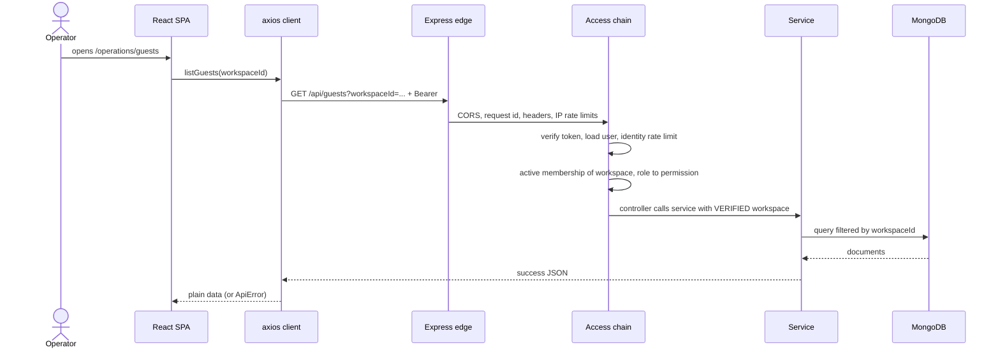
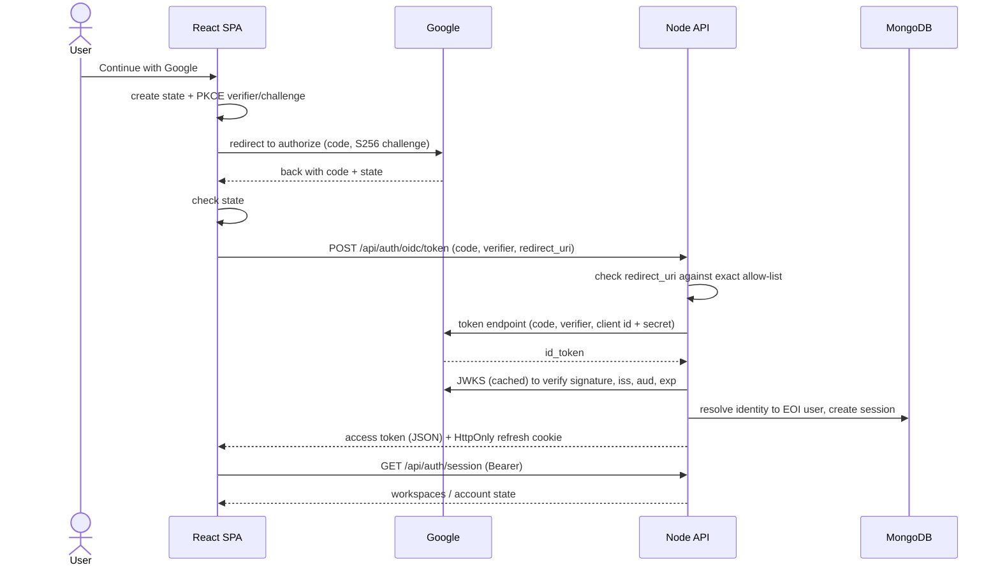
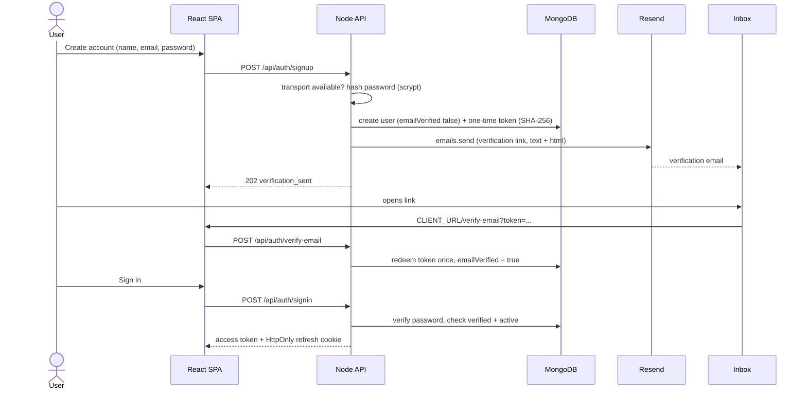
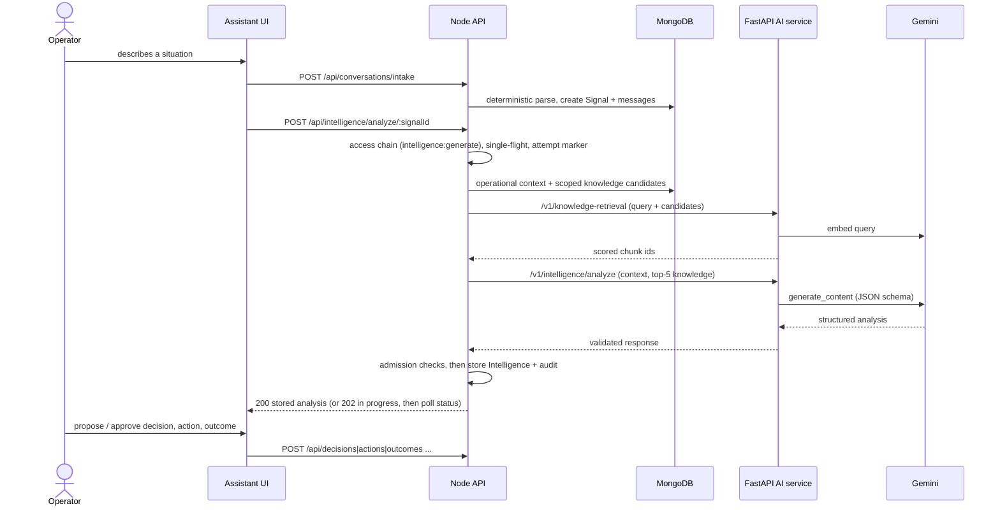

# EOI Guest Intelligence — end-to-end flows

Every step below was traced in source at commit `7ad1d8d6a27faba838e40f87703b8e59996bb7c6`; the right-hand column gives the file and lines that
perform it. Interactive versions of flows 1–5 are the guided views ("1 · Authenticated request" … "5 · Deployment") inside
[`03-eoi-master-architecture.html`](03-eoi-master-architecture.html). The sequence diagrams use Mermaid (rendered by GitHub and most Markdown viewers).
Secrets, tokens, URLs with tokens and `.env` values are never shown.

---

## 1. Normal (authenticated) application request

Example: an operator opens the Guests page. The same chain protects every data route.

| # | Step | Source |
|---|---|---|
| 1 | Page hook asks the API client; the workspace id is only a *selector* in the query string | `frontend/src/features/operations/useGuests.js:13`, `frontend/src/services/api.js:184-186` |
| 2 | Request interceptor attaches `Authorization: Bearer <in-memory token>`; if there is no token and one is required it refreshes first | `frontend/src/services/api.js:123-140` |
| 3 | Express: exact-origin CORS (credentials) → `X-Request-Id` → security headers → per-IP anonymous and client limiters, all **before** any body parsing | `backend/app.js:20-34` |
| 4 | `requireAccess("operations:view")` = authenticate → identity limiters → JSON body parser → workspace membership → permission | `backend/src/routes/guestRoutes.js` (route table), `backend/src/auth/authorize.js:54-61` |
| 5 | Authenticate: parse Bearer, verify (EOI HS256 or OIDC/JWKS), load `User` by id or issuer+subject, reject disabled users on every request | `backend/src/auth/authenticate.js:44-77` |
| 6 | Membership: user, workspace and membership loaded; "not a member / revoked / missing" all answer 404; role must be valid; `req.actor` gains `workspaceId` + `role` | `backend/src/auth/membership.js:27-43` |
| 7 | Permission comes only from the server-side role map | `backend/src/auth/authorize.js:34-46`, `backend/src/auth/roles.js:43-49` |
| 8 | Controller passes the **verified** `req.actor.workspaceId` to the service; service queries are workspace-scoped (`findInWorkspaceOr404`, `workspaceId` in filters) | `backend/src/controllers/guestController.js`, `backend/src/services/queryHelpers.js:44` |
| 9 | Response `{success, data}` / `{success, data, pagination}`; security headers include `Cache-Control: no-store` | `backend/src/utils/response.js`, `backend/src/middleware/securityHeaders.js:19-32` |
| 10 | A 401 triggers one refresh (cookie) and a retry; failures become `ApiError` | `frontend/src/services/api.js:142-160` |

## 2. Google authentication

| # | Step | Source |
|---|---|---|
| 1 | Sign-in starts: PKCE verifier+challenge, random `state`, transaction stored in `sessionStorage` (no credentials), redirect to the provider's authorization endpoint (discovered from `VITE_OIDC_AUTHORITY`) | `frontend/src/services/auth/oidc/oidcSession.js:182`, `…/oidcFlow.js:21-44` |
| 2 | Callback parsed and `state` verified; failures end on an explicit screen and never auto-retry | `frontend/src/services/auth/oidc/oidcFlow.js:46-64`, `oidcSession.js:221-226` |
| 3 | Browser posts `{code, code_verifier, redirect_uri}` to the backend exchange URL (no client secret in the browser) | `frontend/src/services/auth/oidc/oidcFlow.js:93`, `backend/src/routes/authRoutes.js:39` |
| 4 | Backend validates code/verifier shape and the **exact** redirect URI, discovers the token endpoint (issuer must match), posts to Google with the server-held client secret, `redirect: "error"` | `backend/src/services/oidcExchangeService.js:42-63,65-105` |
| 5 | ID token verified (issuer, audience, signature, algorithm, exp, iat, sub) by the OIDC verifier | `backend/src/services/oidcExchangeService.js:96-114`, `backend/src/auth/oidcTokenVerifier.js:34` |
| 6 | With `AUTH_PROVIDER=eoi`: identity resolved to a user (linked → user; same issuer+subject → user; verified-email password account → **link required**; else self-register if enabled, otherwise "access restricted") | `backend/src/services/googleLoginService.js:40-100`, `backend/src/controllers/authController.js:26-35` |
| 7 | Session created: `AuthSession` row, refresh secret stored as SHA-256, `koi_rt` HttpOnly cookie (`Path=/api/auth`), access token in the JSON body | `backend/src/services/authSessionService.js:43-100`, `backend/src/controllers/authController.js:14-18`, `backend/src/auth/cookies.js:18-58` |
| 8 | SPA keeps the access token in memory and asks `/api/auth/session` (identity-only route) for the person's own workspaces | `frontend/src/services/auth/oidc/oidcSession.js:135`, `backend/src/routes/authRoutes.js:57`, `backend/src/services/accountService.js:71` |

If the Google email matches a verified password account, the SPA shows the link screen; `POST /api/auth/google/link` needs the account password plus the short-lived link ticket (`backend/src/auth/eoiTokens.js` LINK ticket, `googleLoginService.js`).

## 3. Email + password authentication (with Resend)

| # | Step | Source |
|---|---|---|
| 1 | Form validation in the browser; request via `fetch` with `credentials: "include"` and `X-KOI-Request` | `frontend/src/components/auth/SignUpPage.jsx`, `frontend/src/services/auth/eoiAuthApi.js:30-40` |
| 2 | Public route behind a per-IP limiter and a 4 KB strict JSON parser | `backend/src/routes/authRoutes.js:43` |
| 3 | If no email transport is configured → 503 `EMAIL_DELIVERY_UNAVAILABLE`; password hashed with scrypt even for existing addresses (timing); existing address → "account exists" mail and the *same* 202 answer | `backend/src/services/passwordAuthService.js:105-125` (`assertEmailTransport`, `signUp`) |
| 4 | New `User` (`emailVerified:false`) + `AuthToken` (32 random bytes, only SHA-256 stored, 24 h) | `backend/src/services/passwordAuthService.js:60-70,126-137` |
| 5 | `sendEmail` → configured transport; production uses **Resend** (`KOI_EMAIL_TRANSPORT=resend`), `emails.send({from,to,subject,text,html})` with a 15 s timeout; link = `CLIENT_URL/verify-email?token=…` | `backend/src/services/emailService.js:137-175,179,187-215`, `backend/src/config/emailConfig.js:103` |
| 6 | If delivery fails the token **and** the just-created unverified user are removed → 503 `EMAIL_DELIVERY_FAILED`; nothing claims success | `backend/src/services/passwordAuthService.js:138-147` |
| 7 | The link opens the SPA page (reachable signed-in or not); it posts the token; the token is redeemed atomically (`usedAt`) and the user marked verified | `frontend/src/app/App.jsx:31-33`, `frontend/src/components/auth/VerifyEmailPage.jsx`, `backend/src/services/passwordAuthService.js:148-153` |
| 8 | Sign-in: scrypt verify (dummy verify for unknown users); unverified → 403 `EMAIL_NOT_VERIFIED`; success → `createSession(method: password)` | `backend/src/services/passwordAuthService.js:165-180` |
| 9 | Forgot/reset: generic 202; reset token 30 min; resetting revokes every session of the user | `backend/src/services/passwordAuthService.js:181-216` |

## 4. AI assistant flow

| # | Step | Source |
|---|---|---|
| 1 | Sending a message records the report (or asks one question) **and** triggers one explicit assessment request; opening/refreshing never calls the model | `frontend/src/features/assistant/useCaseGeneration.js:1-25`, `frontend/src/pages/AssistantPage.jsx:11-18` |
| 2 | `POST /api/conversations/intake` (`operations:manage`) → deterministic interpreter (no model) → `createSignal`; assistant messages are server-written | `frontend/src/services/api.js:241`, `backend/src/routes/conversationRoutes.js`, `backend/src/services/signalIntakeService.js:71`, `signalInterpreter.js:167` |
| 3 | `POST /api/intelligence/analyze/:signalId`: bearer → membership → `intelligence:generate` → AI-tier workspace limiter | `backend/src/routes/intelligenceRoutes.js:17`, `backend/src/auth/authorize.js:54-61` |
| 4 | Single-flight per (workspace, signal, level); durable attempt marker; stored analysis returned without a model call; response window then **202** | `backend/src/services/intelligenceAnalysisService.js:152-188`, `analysisAttemptService.js:59`, `backend/src/controllers/intelligenceController.js:35-37` |
| 5 | Operational context built in Node (bounded, allow-listed, no guest contact data, ≤3 prior analyses/decisions) | `backend/src/services/operationalContextService.js:44-80` |
| 6 | Knowledge candidates selected in the MongoDB query (workspace, status, visibility ceiling, property/unit scope, effective window, has embedding); Python scores; Node re-verifies, applies relevance floor, keeps top-5 | `backend/src/services/knowledgeRetrievalService.js:112,235`, `ai-service/app/routers/retrieval.py:50` |
| 7 | Optional learning context only when `KOI_LEARNING_CONTEXT_ENABLED=true` (default off) | `backend/src/services/intelligenceAnalysisService.js:278-281`, `runtimeConfig.js:224` |
| 8 | Node → `/v1/intelligence/analyze` with `X-KOI-Service-Token`; body is `{context, knowledge, authorizedLevel[, operationalHistory][, learning]}` | `backend/src/services/ai/aiServiceClient.js:41,113-124` |
| 9 | FastAPI checks the token, drops knowledge above the caller's level, builds the prompt from the supplied context only, calls Gemini with a JSON response schema (`LLM_PROVIDER=gemini`; `test` is a deterministic stub) | `ai-service/app/main.py:52-66`, `ai-service/app/routers/analysis.py:31-49`, `…/gemini_analysis_client.py:194,264` |
| 10 | Node validates before storing: schema, provider identity, claims vs evidence, safety policy, prose consistency, foreign identifiers, confidence ceiling | `backend/src/services/intelligenceAnalysisService.js:36-100` |
| 11 | `createAnalysisIntelligence` stores the analysis (provenance from Node's own retrieval); `recordAnalysisAdmission` audits accepted and rejected attempts | `backend/src/services/intelligenceAnalysisService.js:309-345`, `backend/src/services/intelligenceService.js:161` |
| 12 | The SPA polls `GET /api/intelligence/analysis-status/:signalId` (2 s, 3 s, 3 s, then 5 s) only while in progress, then reads the stored analysis | `frontend/src/features/assistant/analysisAttemptController.js:32-33,104`, `frontend/src/services/api.js:519` |
| 13 | Decision → Action → Outcome are human-reviewed steps; nothing is executed | `frontend/src/features/assistant/useCaseDecision.js:77-93`, `useCaseAction.js:84-88`, `backend/src/routes/decisionRoutes.js`, `actionRoutes.js`, `outcomeRoutes.js` |

## 5. Guest intelligence flow (data → stored intelligence)

1. **Input data** — operational records enter through the structured screens (Property, Unit, Guest, Stay), the conversational intake (Signals), or CSV import (`POST /api/imports`, API-only). Business knowledge enters through knowledge-document upload (`POST /api/knowledge-documents/upload`, API-only). Sources: `backend/src/routes/{propertyRoutes,guestRoutes,stayRoutes,signalRoutes,conversationRoutes,importRoutes,knowledgeDocumentRoutes}.js`.
2. **Storage** — facts are stored as facts in MongoDB (Signal/Guest/Stay/Unit/Property…); knowledge is extracted (PDF/DOCX/text), chunked, embedded through the AI service and stored on `KnowledgeChunk` (`knowledgeEmbeddingService.js:84`). AI output is stored separately as `Intelligence` and references facts by id.
3. **Retrieval** — for one Signal: related entities (stay → guest → unit → property), earlier analyses and reviewed decisions of the same kind of problem (`historyRelevance.js`), and the top-5 relevant knowledge chunks (scoped in the query; similarity computed in Python).
4. **Processing / AI** — Gemini (`gemini-3.1-flash-lite`) receives only the bounded context + chosen chunks and returns structured JSON (situation, impact, recommendation, claims, urgency, recommended action type, confidence).
5. **Intelligence** — Node's admission checks decide whether the output may be stored; the stored record carries provenance (provider, model, chunk ids), the server-derived safety state and an admission audit row.
6. **Frontend** — the case card shows facts, the assessment, safety, and the human decision/action/outcome panels (`frontend/src/features/assistant/SignalCaseCard.jsx:36`).

## 6. Data flow summary (what crosses each boundary)

| From → to | Data | Not sent / protections | Source |
|---|---|---|---|
| Browser → Node | Bearer access token (memory), workspace selector, form/chat text; refresh cookie only to `/api/auth/*` | Role, permission and knowledge level are never read from the request | `api.js:123-140`, `cookies.js:18-58`, `authenticate.js:6-28` |
| Node → MongoDB | Workspace-scoped queries and writes | Foreign workspace ids answer 404; URI must name a database outside dev | `queryHelpers.js:29-60`, `mongoSafety.js:65` |
| Node → AI service | Bounded context, retrieved chunks, level, optional history/learning; or query text + Node-selected candidates; or chunk text for embedding | **No workspace id, no user id, no tool or database handle**; service token; request id (uuid only) | `operationalContextContract.js`, `aiServiceClient.js:25-60,78,92,113` |
| AI service → Gemini | Prompt built from the supplied context; texts to embed | Approved model only; response schema enforced; output re-validated by Node | `ai-service/app/provider_policy.py:31`, `gemini_analysis_client.py:194` |
| Node → Resend | `from`, `to`, subject, text, html (contains the one-time link) | API key in environment only; failure logs class/status/redacted detail, never address/link/token | `emailService.js:152-160,187-215` |
| Browser ↔ Google | Authorization request with PKCE; code returns via redirect | Client secret never in the browser | `oidcFlow.js:26-44` |
| Node ↔ Google | Code + verifier + client secret → ID token; JWKS | Exact redirect-URI allow-list; no redirect following; generic failure answers | `oidcExchangeService.js:65-125` |

## 7. Deployment flow (as operated)

`Browser → Vercel (static SPA) → Render Node API → MongoDB Atlas`; the Node API also calls `Render AI service → Gemini`, `Resend` and `Google`.
Only the SPA rewrite (`frontend/vercel.json`) and the Node/Python start commands are defined in the repository; the platforms, URLs and environment variables are configured in the Vercel, Render and Atlas dashboards (not verifiable from code — see U1 in [`07-architecture-source-map.md`](07-architecture-source-map.md)).
Cross-origin by design: the API allows exactly one browser origin (`CLIENT_URL`), cookies are `Path=/api/auth`, and the browser sends a custom header on cookie routes (`backend/src/auth/cookies.js:18-58`).
